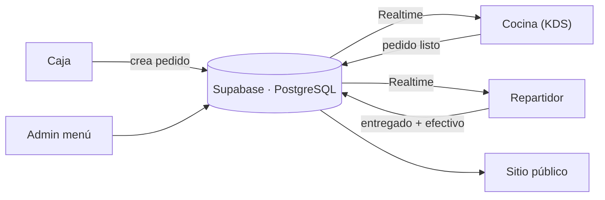

# El Mezquite — Sitio web y POS en tiempo real

**Landing pública + sistema de punto de venta con 3 pantallas sincronizadas en tiempo real para una dark kitchen en operación.**
 
*Public website + real-time 3-screen point-of-sale system for a live dark kitchen.*

<!-- Agrega aquí una captura grande del sitio (guárdala en /docs):

-->

---

## El problema · The problem

El Mezquite es una dark kitchen en Linares, N.L. (hamburguesas, tacos de arrachera y entradas) que trabaja solo a domicilio, de miércoles a lunes por la noche. Necesitaba **presencia en línea con su menú** y una forma de **coordinar caja, cocina y reparto en tiempo real** durante el servicio.

> *A delivery-only kitchen needed an online presence and a way to coordinate cashier, kitchen and delivery in real time.*

## Funcionalidades · Features

### Sitio público
- Historia y misión del negocio con identidad norteña.
- **Menú completo** administrable desde el panel (platillos, precios, disponibilidad y destacados).
- **Feed de Instagram integrado automáticamente** (@elmezquitedk).
- Botón de **pedido directo por WhatsApp**.
- Animaciones de scroll con Framer Motion.

### Sistema POS (3 pantallas, cada una con su login)
| Pantalla | Ruta | Qué hace |
|---|---|---|
| Caja | `/pos/caja` | Captura y gestión de pedidos. |
| Cocina | `/pos/cocina` | Pantalla tipo KDS (Kitchen Display System) con lo que hay que preparar. |
| Repartidor | `/pos/repartidor` | Pedidos asignados, marcar como entregado, link a Google Maps y resumen de efectivo a rendir. |
| Admin | `/pos/admin/menu` | Edición de platillos, precios, disponibilidad y destacados de la home. |

- **Sincronización en tiempo real** entre las 3 pantallas vía Supabase Realtime, sin servidor de sockets propio.
- **Detección de conexión** en tiempo real para avisar si una pantalla se desconecta.

## Arquitectura · Architecture

## Stack

| Capa | Tecnología |
|---|---|
| Frontend | Next.js · React · TypeScript · Tailwind CSS · Framer Motion |
| Backend / Datos | Supabase (PostgreSQL, Auth, Realtime) |
| Despliegue | Vercel |
| Integraciones | Instagram feed · WhatsApp |

## Capturas · Screenshots

<!-- Agrega tus capturas en /docs y descomenta:
| Caja | Cocina | Repartidor |
|---|---|---|
|  |  |  |
-->

## Próximos pasos · Roadmap

- [x] Gestión de destacados y fotos reales del menú
- [x] Mejoras al panel de repartidor
- [x] Detección de conexión en tiempo real
- [ ] POS como **PWA instalable** (PC de caja y tablet de cocina)
- [ ] **Impresión automática de tickets** en impresora térmica
- [ ] Dominio propio
- [ ] Animaciones avanzadas con GSAP / Three.js

## Código · Source code

El código fuente es **privado**. Puedo mostrar una demostración en vivo en entrevista.
 *Source code is private — live walkthrough available on request.*

---

Desarrollado por **[Alfonso Méndez](https://github.com/meyern01)** · **[Kodiak](https://getkodiak.dev)**

